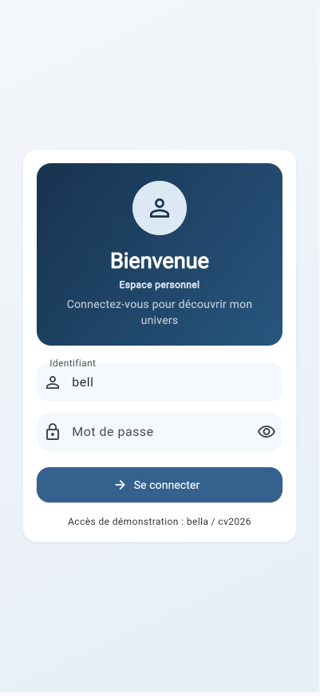
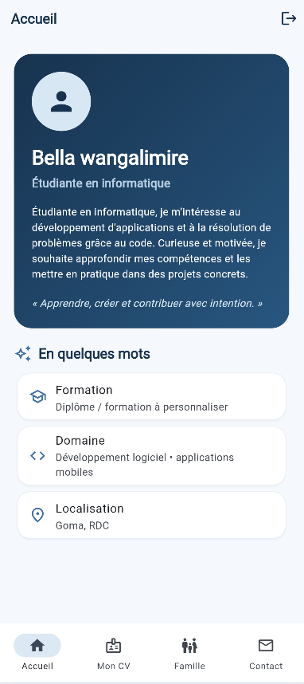
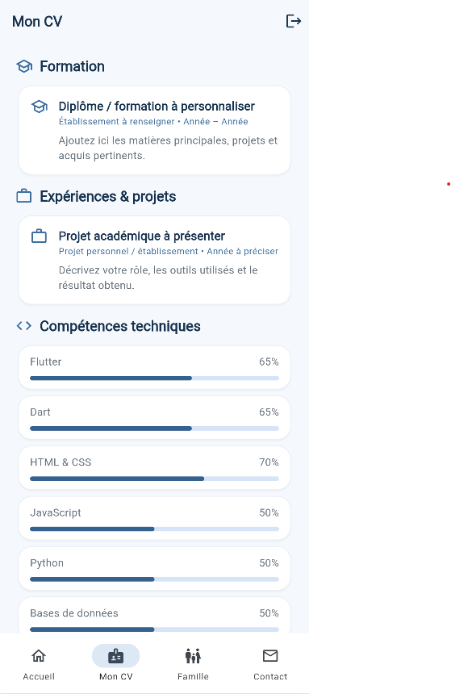
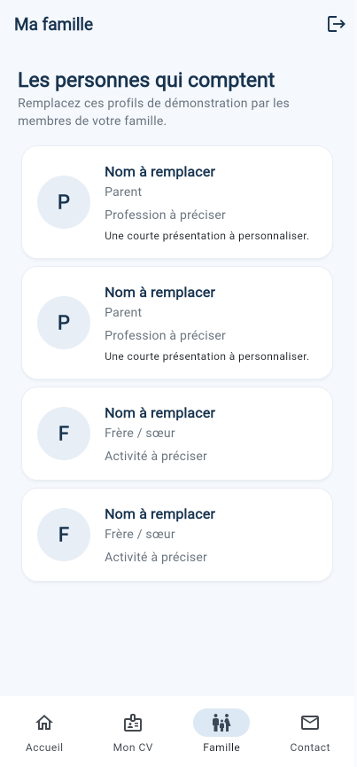
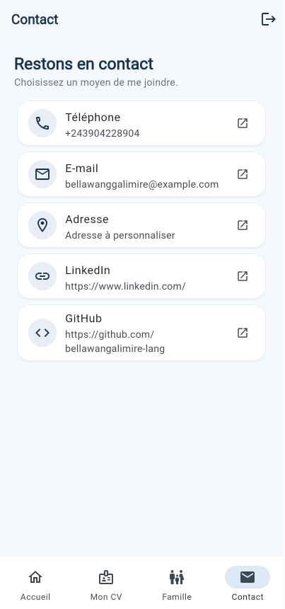

# cv_flutter_bella

Application Flutter de présentation d’un CV, de coordonnées et d’une famille. La version TP2 conserve les écrans et le thème du TP1, remplace la connexion locale par l’API PHP et charge les membres de famille depuis MySQL.

## Fonctionnalités

- Connexion par e-mail et mot de passe auprès de `POST /accounts/login`.
- Création d’un compte depuis l’écran de connexion auprès de `POST /accounts/register`, avec confirmation du mot de passe; après réussite, l’adresse est reportée dans le formulaire de connexion.
- Écrans Accueil, Mon CV, Famille et Contact, avec le thème bleu, les transitions, la navigation et la déconnexion du TP1.
- Interface adaptative : navigation inférieure sur mobile, navigation latérale sur grand écran, contenu centré et cartes Famille disposées en une, deux ou trois colonnes selon la largeur.
- Lecture, ajout, modification et suppression des membres avec confirmation et rechargement depuis le serveur.
- Choix et aperçu d’une photo de membre, envoyée à l’API en multipart (JPG, PNG, GIF ou WebP, 2 Mo maximum); les photos existantes restent conservées lorsqu’on modifie un membre sans en sélectionner une nouvelle.
- Appel, e-mail, carte et profils LinkedIn/GitHub via `url_launcher`.

Les données du CV et les captures d’écran du TP1 sont conservées. Les anciennes cartes familiales fictives ne sont plus affichées comme des données serveur.

## Technologies et packages

- Flutter / Dart, Material 3
- `http` pour l’API REST
- `image_picker` pour sélectionner les photos de famille
- `url_launcher` pour les actions de contact
- `cupertino_icons`

## Architecture

```text
lib/
├── data/                 # Données du CV, compétences et contact conservées
├── models/family_member.dart
├── services/api_service.dart
├── theme/app_theme.dart
└── main.dart             # Connexion, navigation, écrans et composants
assets/images/            # Ressources locales
screenshots/              # Captures TP1 conservées
```

## Installer et démarrer l’API

L’API de l’enseignant est un projet séparé : [espoirbaraka/api-test](https://github.com/espoirbaraka/api-test). Le code PHP n’est pas installé automatiquement par ce dépôt Flutter. Avant d’utiliser la connexion ou la page Famille :

1. Copier le contenu du dépôt API dans `C:\xampp\htdocs\api-test`.
2. Dans XAMPP Control Panel, démarrer **Apache** et **MySQL**.
3. Créer la base `api` dans phpMyAdmin, puis importer `api.sql` une seule fois. Le script crée `account`, `famille_membre` et `tbl_etudiant`; ne le réimportez pas dans une base qui contient déjà des données à conserver.
4. Copier `.env.example` en `.env` à la racine de l’API et adapter les identifiants MySQL si nécessaire :

   ```env
   DB_HOST=127.0.0.1
   DB_PORT=3306
   DB_DATABASE=api
   DB_USERNAME=root
   DB_PASSWORD=
   ```

5. Vérifier une route déclarée, par exemple `http://localhost/api-test/public/famille-membres`. La racine `/public` est nécessaire. L’API répond en JSON et ne protège aucun endpoint : le succès du login Flutter ne crée pas une session ou un jeton et ne sécurise pas les routes CRUD.
6. Dans l’application, toucher **Créer un compte**, saisir une adresse e-mail et un mot de passe d’au moins 6 caractères, puis confirmer le mot de passe. L’application appelle la route d’inscription ci-dessous; après création, l’adresse est préremplie sur l’écran de connexion.

L’API est écrite en PHP sans framework et n’inclut pas de `composer.json` ou de dépendance Composer. Ses réponses utilisent `{ "success": true, "message": "...", "data": ... }`; les erreurs comportent `message`, parfois `errors`.

## Routes utilisées

| Méthode | Route | Usage Flutter |
|---|---|---|
| POST | `/accounts/register` | Créer un compte; corps JSON `email`, `password` |
| POST | `/accounts/login` | Connexion; corps JSON `email`, `password` |
| GET | `/famille-membres` | Charger la liste |
| POST | `/famille-membres` | Ajouter un membre en JSON |
| PUT | `/famille-membres/{id}` | Modifier un membre en JSON |
| DELETE | `/famille-membres/{id}` | Supprimer un membre |

Les champs JSON du membre sont `nom`, `postnom`, `prenom`, `lieu_naissance`, `date_naissance` (format `AAAA-MM-JJ`) et `parente`. Le serveur expose aussi GET par identifiant et POST multipart pour les images; l’interface ne les utilise pas actuellement. L’API autorise CORS et répond aux requêtes OPTIONS.

## Configurer l’URL

Par défaut, l’application utilise `http://localhost/api-test/public` sur Windows et le web, et `http://10.0.2.2/api-test/public` sur l’émulateur Android. Sur un téléphone physique, fournissez l’adresse IP locale du PC XAMPP. L’URL peut être remplacée au lancement :

```bash
flutter run --dart-define=API_BASE_URL=http://192.168.1.10/api-test/public
```

Utilisez l’adresse et le protocole accessibles depuis l’appareil. L’API locale de démonstration fonctionne en HTTP; Android est configuré pour l’autoriser.

## Installer et lancer Flutter

Depuis la racine du projet :

```bash
flutter pub get
flutter run
```

Contrôles :

```bash
flutter analyze
flutter test
```

L’API locale doit être démarrée avant d’utiliser les fonctionnalités qui en dépendent. Les autres écrans restent consultables indépendamment.

## Captures d’écran TP1

Les captures existantes sont conservées dans `screenshots/` :







## Démonstration vidéo

[Regarder la démonstration de l’application Flutter](./screenshots/video_tp.mp4)

## GitHub

Le dépôt Flutter associé est `https://github.com/bellawangalimire-lang/cv_flutter_bella`. Les modifications sont locales. Après revue, vous pourrez les publier avec :

```bash
git add README.md pubspec.yaml pubspec.lock lib android/app/src/main/AndroidManifest.xml test screenshots/video_tp.mp4
git commit -m "Connect CV app to family REST API"
git push origin main
```
